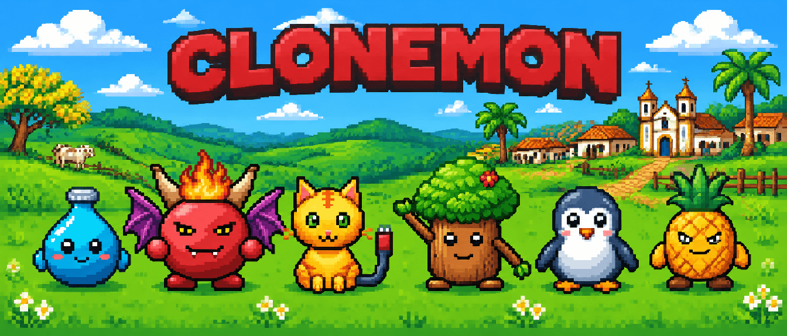
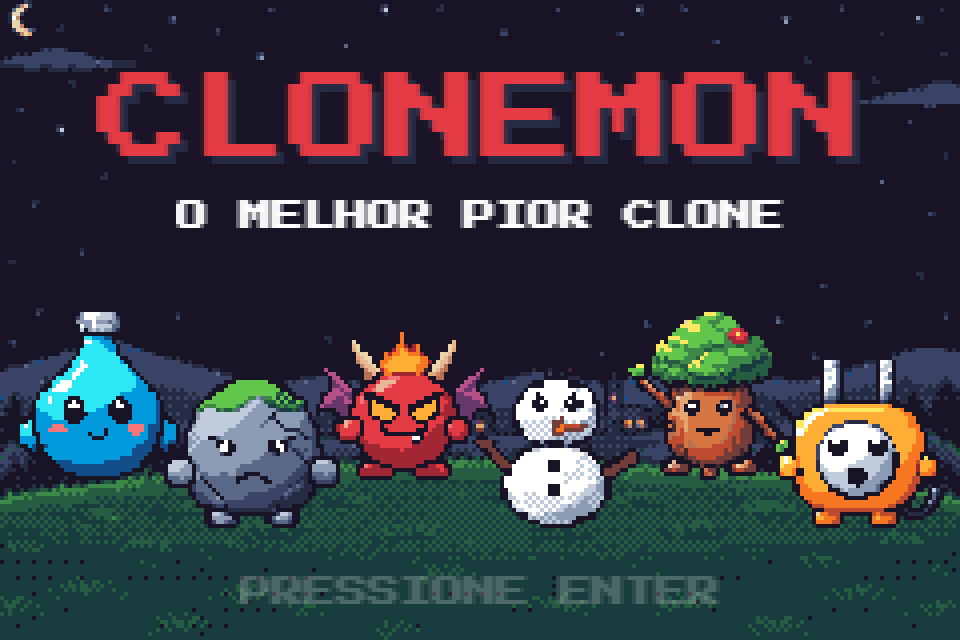
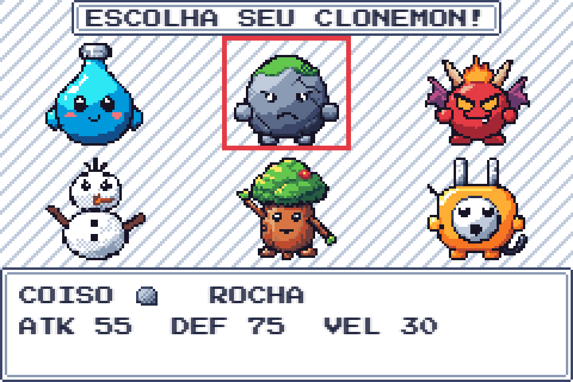
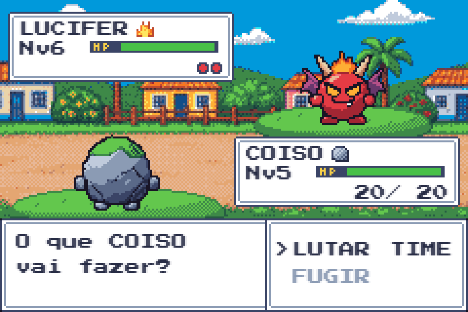
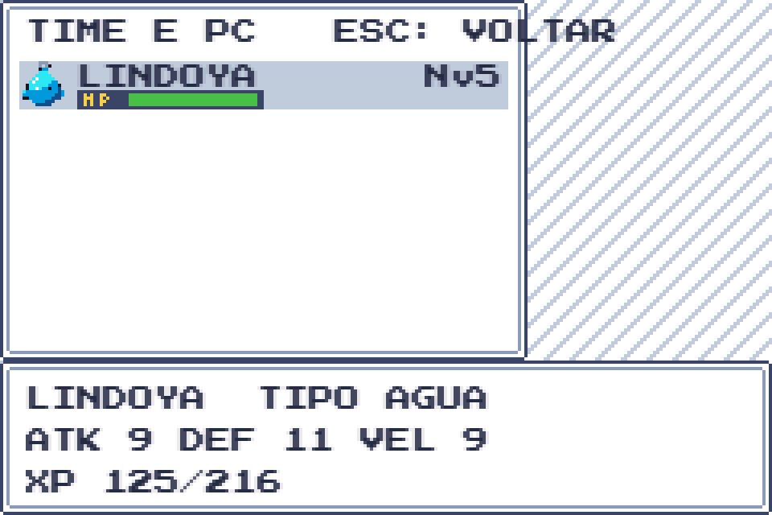

# 👾 CLONEMON



> The best worst monster-catching clone you've ever seen, now in pixel art.

Turn-based battles against wild clonemons, a team of up to 6, XP and levels, and progress saved on the server. A full rewrite of my original console OOP project: Spring Boot + PostgreSQL on the backend and Phaser in the browser.

| | |
|---|---|
|  |  |
|  |  |

> The in-game text is in Brazilian Portuguese, and most monster and move names are local jokes.

## ✨ Technologies

| Part | Technologies |
|---|---|
| Backend | `Java 21`, `Spring Boot 4` (Web MVC, Data JPA, Security with JWT), `Flyway`, `PostgreSQL` |
| Frontend | `TypeScript`, `Vite`, `Phaser 4`, Press Start 2P font |
| Art | Pixel art in the ENDESGA 32 palette: monsters and backdrops are PNGs, the map and UI are drawn in code |
| Tests | `JUnit 5`, `AssertJ`, `Testcontainers`, `MockMvc`, `Vitest`, `Playwright` |

## 🚀 Features

- **12 clonemons** - 6 starters plus 6 found only in the wild, inspired by Brazilian culture (the pink river dolphin legend, Sugarloaf Mountain, a pepper with its tail on fire…)
- **Type cycle** - Each type deals double damage to the next and half to the previous one: `WATER → ROCK → FIRE → ICE → GRASS → THUNDER → WATER`
- **Level-up moves** - Every clonemon learns 2 new moves as it levels, some with status effects (burn, freeze, paralysis, sleep) or stat changes
- **Recruit by winning** - Beat a wild clonemon and it joins your team (or goes to the PC if the team is full)
- **Trainer line of sight** - Trainers on the route challenge you when you cross their view, and you can't run away
- **Backdrops that follow the clock** - Wild battles happen in a field by day, at sunset in the late afternoon and under the moon at night; trainer battles take place in the village
- **Battle helpers** - Super-effective / not-very-effective markers on each move, damage shown as %, and a turn-by-turn battle log
- **Replays** - The last 20 battles, with pause, step back and forward, speed control and a mirrored view from the opponent's side
- **Saved every turn** - Close the browser mid-battle and continue later

## 📍 The Process

CLONEMON started as a console game for an object-oriented programming course at university (UAM, Computer Science), built with two classmates. Years later I came back to it and rewrote everything as a real web game: a Spring Boot API with JWT auth and Flyway migrations, a Phaser front end, and pixel art drawn entirely in code. The original console version still lives in [`legacy/`](legacy/) so you can compare the two.

The art went through two stages. First every sprite was drawn in code, pixel by pixel, which is still how the map, the characters and the UI are made. Later I used those code-drawn monsters as references for an image model (GPT Image, through Higgsfield) and wrote a script that cuts out the background, shrinks each drawing to the 48x48 grid and snaps it to the same 32-colour palette, so the generated monsters and backdrops sit next to the hand-coded art without clashing. Any monster without a PNG still falls back to its code-drawn version.

I wanted the rewrite to be tested like a production app, so the backend has domain, use case, persistence and API tests running against a real Postgres through Testcontainers, and a Playwright test plays a full match in the browser.

## 🎯 Documentation

- [Architecture, API and tests](docs/architecture.md)
- [Database and ER diagram](docs/database.md)
- [Deploy (Render + Neon)](docs/deploy.md)

## 🕹️ How to Play

1. Create a trainer and pick your first clonemon. You start in Vila Capim, at your front door.
2. Walk around with the arrow keys. Wild clonemons close to your team's level show up in the tall grass on Route 1.
3. Winning gives XP and the defeated clonemon joins your team.
4. Trainers CAIO, BIA and ZECA watch the route and challenge anyone who crosses their line of sight.
5. At the **Clonemon Center** (the red-roof building) your team recovers HP and PP. Enter reads signs and talks to people.
6. Enter with nothing in front of you, or Esc, opens the menu. In **TEAM** you reorder your team and swap monsters with the PC.
7. In battle, press **H** for the battle log. Long battles speed up on their own.
8. **REPLAYS** (pause menu) holds the last 20 battles: Enter pauses, ←/→ step one turn, ↑/↓ change speed, **V** shows the opponent's side.

**Controls:** arrows navigate, Enter / Space / Z confirm, Esc / Backspace / X go back, M toggles sound. The mouse works too.

## 🚦 Running the Project

**Just want to play (Windows)?** With Docker Desktop open, double-click [`jogar.cmd`](jogar.cmd). It starts everything and opens the game at http://localhost:8081. The first run takes a few minutes.

> Opening `index.html` straight from disk does not work: the browser blocks the game outside a server.

To develop you need Java 21+, Node 22+ and Docker.

**Quick start (temporary database).** The backend starts a throwaway Postgres on its own through Testcontainers. Data is gone when it stops.

```bash
cd backend && ./mvnw spring-boot:test-run -Dspring-boot.run.main-class=br.clonemon.TestClonemonApplication
```

```bash
cd frontend && npm install && npm run dev
```

Open http://localhost:5173.

**With a persistent database:**

```bash
docker compose up -d
```

```bash
cd backend && ./mvnw spring-boot:run
```

Then start the frontend as above.

| Service | Port | Variable |
|---|---|---|
| Frontend (Vite) | 5173 | — |
| API | 8081 | `PORT` |
| PostgreSQL (compose) | 5433 | `DB_URL`, `DB_USER`, `DB_PASSWORD` |

In production, set `JWT_SECRET` (at least 32 bytes).

**Same as production (Docker).** The deploy image, with game and API together at http://localhost:8081:

```bash
docker compose --profile app up -d --build
```

To publish it online, see [docs/deploy.md](docs/deploy.md).

## 🧪 Tests

```bash
cd backend && ./mvnw verify
```

```bash
cd frontend && npm run typecheck && npm test
```

```bash
cd frontend && npm run test:e2e
```

- `verify` runs the domain, use case, persistence and API tests (needs Docker) and writes coverage to `backend/target/site/jacoco/index.html`.
- `test:e2e` plays a full match in the browser and starts the backend on its own (needs Docker). On Windows it uses the installed Edge.
- `npm run art:preview` saves a screenshot of all the pixel art to `frontend/test-results/screens/art-gallery.png`.

## 🎨 Art Pipeline

The PNGs in `frontend/src/assets/` are built from high-resolution originals kept in `frontend/art-src/` (not versioned).

```bash
cd frontend && npm run art:build
```

- `art:build` runs `scripts/pixelize.mjs` over every original it finds and skips the ones that are missing, so it is safe to run with only part of the originals.
- `npm run art:sheet` saves all the final battle sprites, enlarged, to `frontend/art-src/preview-monsters.png` for review.
- To add art for a new monster, put its sheet (front view on the left, back view on the right) in `art-src/monsters/<name>.png` and add the name to `SHEETS` in the script.

## 🙌 Credits

Original OOP project (UAM, Computer Science), supervised by Prof. André Santana:

- Victor Holanda de Oliveira
- Lucas Sousa Ferreira dos Santos
- Gabriel Alves Memoli
